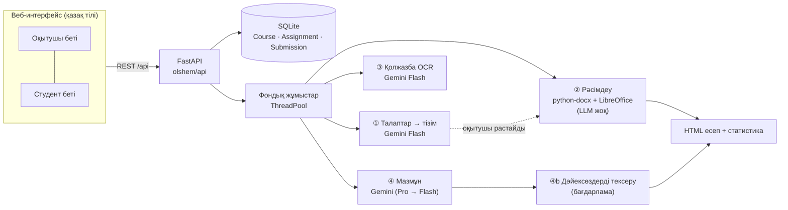
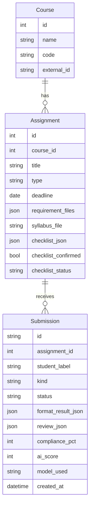

# Өлшем — жазбаша жұмыстарды ЖИ арқылы алдын ала тексеру жүйесі

> **«Әр жұмысқа — бір өлшем.»**
> Өлшем — әр жұмысты бірдей талаппен, әділ өлшеу. Соңғы баға мен шешім — оқытушыда.

«ЖИ-әзірлемелер – 2026» байқауына (Л.Н. Гумилев атындағы ЕҰУ) арналған жоба.
Команда: **Ербол Елқұт** (капитан), Базаралы Асқат, Елюбаев Алихан, Мырзабай Дінмұхамед — 6В06112 «Жасанды интеллект технологиялары».

---

## 1. Мәселе

* Оқытушы әр курстық жұмыста, БӨЖ-де, рефератта бір қателерді қайта-қайта тексереді: өрістер, қаріп, интервал,
  бет саны, бөлімдер, кесте атаулары, әдебиеттер реті. Бұл — уақыттың көп бөлігі, ал мазмұнға уақыт аз қалады.
* Студент талаптарды (ПОӘК, әдістемелік нұсқау) толық оқымайды, қатесін тек баға алғанда біледі.
* Тексеру әр оқытушыда әртүрлі: бір өлшем жоқ.
* ChatGPT-ге жұмысты жай «тексер» деп беру — нақты өлшем бермейді (бет нөмірін, өріс сантиметрін ол көрмейді),
  дәлелсіз тұжырым жасайды және студенттің жеке деректерін сыртқа жібереді.

## 2. Шешім

1. **Оқытушы** талаптарын жүктейді (ПОӘК/силлабус PDF, фото немесе мәтін). ЖИ оларды **құрылымдалған тексеру тізіміне**
   айналдырады. Оқытушы тізімді түзетеді (ереже қосу/өшіру, мәнін өзгерту, «міндетті емес» деп белгілеу) және **растайды**.
2. **Студент** жұмысын (.docx, .pdf немесе қолжазба беттерінің фотосы) жүктейді.
3. Жүйе тізім бойынша тексереді: рәсімдеуді — **бағдарлама дәл өлшейді** (бет нөмірімен), мазмұнды — **ЖИ бағалайды**,
   әр тұжырымы жұмыстан алынған **дәйексөзбен** және оны бағдарлама жұмыс мәтінінен тауып, растайды.
4. Қазақ тіліндегі **есеп**: «талаптарға сәйкестік %» (бағдарлама) және «мазмұн бағасы» (ЖИ ұсынысы) — бөлек көрсетіледі.
5. Оқытушы **топ статистикасын** көреді: ең жиі қателер, орташа сәйкестік.

Кез келген пәнге жарайды: ережелерді оқытушы өзі анықтайды (курстық жұмыс, БӨЖ, реферат, эссе, зертханалық жұмыс).

## 3. Архитектура



```
olshem/
  api/        HTTP қабаты: assignments.py, submissions.py, system.py, deps.py (SSO нүктесі)
  core/       ЖИ мен тексеру логикасы (вебке тәуелсіз)
    llm.py            бір интерфейс, модельдер тізбегі, қайталау/ауысу, JSON-схема
    requirements.py   ① талаптар → Checklist
    format_checker.py ② .docx/.pdf/мәтінді дәл тексеру
    review.py         ③ OCR, ④ мазмұн, ④b дәйексөз тексеру
    privacy.py        LLM-ге жібермес бұрын анонимдеу
    scoring.py        сәйкестік пайызы (тек бағдарлама)
    report.py         қазақша HTML есеп (жарық/қараңғы тақырып, басып шығару)
    pipeline.py       ②→③→④ кезеңдерін біріктіру
  models/     SQLModel кестелері және API схемалары
  services/   фондық жұмыстар, демо режимі, статистика, сақтау, демо деректер
  web/        index.html + static/ (таза JS, құрастыру қажет емес)
demo/         демо тапсырма: ПОӘК, силлабус, тексеру тізімі, ашық үлгі жұмыс және оның кэші
tests/        unit + регрессия + end-to-end smoke
```

## 4. ЖИ кезеңдері және модель таңдау себебі

| Кезең | Кім | Неге осылай |
|---|---|---|
| ① Талаптар → тізім | Gemini 3.5 Flash (резерв: 3.8 Flash, 3.1 Flash-Lite) | PDF/фотоны тікелей оқиды (мультимодаль), JSON-схемамен құрылымдалған шығыс. Тапсырма — ақпарат алу, «ойлау» емес, сондықтан жылдам Flash жеткілікті. Нәтижені оқытушы растайды. |
| ② Рәсімдеу | **Бағдарлама**, LLM жоқ | Өріс, қаріп, өлшем, интервал, шегініс, бет саны, бөлімдер, кесте атаулары, әдебиет реті — өлшенетін нәрселер. LLM оларды «көрмейді» және қателеседі; бағдарлама дәл, тегін, 100% қайталанатын, бет нөмірін көрсетеді. |
| ③ Қолжазба OCR | Gemini 3.5 Flash | Қазақ кирилл қолжазбасын (ә ғ қ ң ө ұ ү һ і) таниды; әр бетке сенімділік деңгейі, күмәнді сөздер `[?сөз?]` деп белгіленеді. |
| ④ Мазмұн | Gemini Pro → 3.8 Flash → 3.5 Flash | Ең күрделі кезең: талаптар PDF + силлабус + ЖИ ережелері + бағдарлама нәтижесі (контекст ретінде) + жұмыс мәтіні + 6-ға дейін сурет. Pro — сапа үшін бірінші; квота/жүктеме болса автоматты Flash-қа ауысады. |
| ④b Дәйексөз тексеру | **Бағдарлама** | ЖИ-дің әр дәйексөзі жұмыс мәтінінен ізделеді. Табылмаса, тұжырым «тексерілмеді» болып, есептен шығады — ЖИ ойдан шығара алмайды. |

`core/llm.py`: әр кезеңге модельдер тізбегі; 503/таймаут → қайталау, 429/404/403 → бірден келесі модель;
іске қосылғанда модельдер тексеріледі (`/api/health`), қолжетімсіздері тізбектің соңына жылжиды.
Модельдерді кодқа тимей `MODELS_*` айнымалыларымен ауыстыруға болады.

> 2026-11-03 өлшемі: тегін деңгейде 3.5 Flash тұрақты; 3.8 Flash / flash-latest шыңда 503 береді; Pro модельдері 429 (тегін квота жоқ).
> Сондықтан бүгін ④ кезең іс жүзінде 3.5 Flash-та жүреді. Billing қосылса — Pro автоматты түрде қолданылады.

**ЖИ-ге қойылған шектеулер:** тек ұсыныс береді; пішімдеуді бағаламайды (оны бағдарлама тексерді); әр тұжырымға дәйексөз
міндетті; дәлел жоқ болса — «тексерілмеді»; мазмұн бағасы мен талаптарға сәйкестік пайызы араластырылмайды.

## 5. API (толығы: `/docs`, OpenAPI: `/openapi.json`)

| Әдіс | Жол | Сипаттама |
|---|---|---|
| POST | `/api/assignments` | Тапсырма құру, талап файлдары/мәтіні, силлабус → ① фонда |
| GET | `/api/assignments`, `/api/assignments/{id}` | Тапсырмалар, тексеру тізімі |
| PUT | `/api/assignments/{id}/checklist` | Оқытушы тізімді түзетеді және растайды |
| POST | `/api/assignments/{id}/extract` | ① кезеңді қайталау |
| POST | `/api/assignments/{id}/submissions` | Жұмыс жүктеу (.docx / .pdf / фотолар) → ②③④ фонда, `202` |
| POST | `/api/assignments/{id}/submissions/sample` | Демо: ашық үлгі жұмысты тексеру |
| GET | `/api/assignments/{id}/submissions` | Тапсырма бойынша жұмыстар (оқытушы) |
| GET | `/api/assignments/{id}/stats` | Топ статистикасы: Top-N мәселе, орташа сәйкестік |
| GET | `/api/submissions/{id}` | Күйі, кезеңдер, нәтиже (`?results=true`) — polling |
| GET | `/api/submissions/{id}/events` | Барысы — Server-Sent Events |
| GET | `/api/submissions/{id}/report` | Қазақша HTML есеп |
| POST | `/api/submissions/{id}/retry` · DELETE `/api/submissions/{id}` | Қайталау · жою |
| GET | `/api/health` | Жүйе, LibreOffice, әр модельдің қолжетімділігі (`?refresh=true`) |
| GET/PUT | `/api/demo-mode` | Демо режимі |

Қате болса, жауап `{"detail": "қазақша түсінікті хабар"}` түрінде.

## 6. Деректер моделі



`checklist_json` — `Checklist{course, assignment, rules[]}`; әр ереже: `id, category, text_kk, check (auto|ai), metric,
value/min/max/items, severity, source_quote, enabled, optional, exclude_appendix, skip_result_tables`.
`Submission.id` — болжауға келмейтін кездейсоқ идентификатор (басқа студенттің есебін санап ашу мүмкін емес).

## 7. SMART.ENU-мен интеграция жоспары

1. **Кіру (SSO):** `olshem/api/deps.py: current_user` — жалғыз ауыстырылатын нүкте. SmartENU OIDC/SAML токенін тексеріп,
   ЕҰУ аккаунтын `User(id, role)`-ға айналдырады. Қалған код өзгермейді.
2. **Деректер:** `Course.external_id` ↔ SmartENU/Platonus пән коды; `Assignment` ↔ пәндегі тапсырма; `Submission.student_label`
   ↔ студент ID. Барлық сыртқы байланыс — REST + OpenAPI арқылы.
3. **Ағын:** SmartENU тапсырма жасағанда `POST /api/assignments`, студент файл тапсырғанда `POST …/submissions`,
   нәтижені `GET /api/submissions/{id}` (немесе SSE) арқылы алып, оқытушы журналына «алдын ала тексерілді» белгісін қояды.
4. **Стандарт:** JSON, ISO-8601 уақыт, UTF-8, HTTP қате кодтары; есеп HTML/PDF.

## 8. Құпиялылық және қауіпсіздік

* **Анонимдеу:** LLM-ге жіберер алдында «Орындаған / Ғылыми жетекші / Тексерген…» жолдарындағы аты-жөн, e-mail, телефон,
  ЖСН және студент енгізген аты `[ЖАСЫРЫЛДЫ]` болып ауыстырылады (`core/privacy.py`, тестпен тексерілген).
* **Сақтау:** файлдар тек серверде (`DATA_DIR/uploads`), кездейсоқ атпен; оқытушы жұмысты/тапсырманы жойса — файл да жойылады.
  ЖИ-ге тек мәтін, талаптар және 6-ға дейін сурет жіберіледі.
* **Кілттер:** `GEMINI_API_KEY` тек орта айнымалысынан; кодта, репозиторийде, суретте жоқ (`.env` — `.gitignore`-да).
* **Жүктеу:** 20 МБ шегі, рұқсат етілген кеңейтімдер + файлдың «сиқырлы байттары» тексеріледі, файл атауы кездейсоқ.
* **Рөлдер:** тапсырма құру, тізімді растау, жою, статистика — тек оқытушы.
* **Тұрақтылық:** кез келген қате → `error` күйі және түсінікті хабар; ЖИ қолжетімсіз болса да рәсімдеу есебі шығады;
  сервер қайта қосылса, аяқталмаған тексерулер қайта кезекке қойылады.
* **Демо деректер:** ашық демода тек команда мүшесінің өз жұмысы (emhana.docx) және синтетикалық жұмыстар.
  Басқа студенттің жұмысы тек ішкі регрессия тестінде, репозиторийге салынбайды (`samples_private/`).

## 9. Іске қосу

### Жергілікті
```bash
sudo apt install libreoffice-writer fonts-liberation   # бет санын анықтау үшін
pip install -r requirements.txt
cp .env.example .env            # GEMINI_API_KEY=... жазыңыз
uvicorn olshem.main:app --reload
# http://localhost:8000  ·  API: http://localhost:8000/docs
```

### Docker
```bash
docker build -t olshem .
docker run -p 7860:7860 -e GEMINI_API_KEY=... olshem
# http://localhost:7860
```

Онлайн орналастыру (Hugging Face Spaces / Render) — [docs/deploy.md](docs/deploy.md).

### Тесттер
```bash
pip install -r requirements-dev.txt
pytest -q          # 26 тест: рәсімдеу, анонимдеу, дәйексөз, модель ауысуы, API end-to-end
```

### Демо режимі
Оқытушы бетіндегі «Демо режимі» қосқышы. Қосулы кезде: ашық үлгі жұмыс үшін бұрын нақты ЖИ жүргізген нәтиже
(gemini-3.5-flash, 2026-11-03) көрсетіледі, демо ПОӘК үшін сақталған тексеру тізімі қолданылады; басқа файлдарда тек бағдарламалық
тексеру жүреді. Есепте бұл **ашық жазылады** («Демо режимі» белгісі). Кэшті жаңарту: `python scripts/build_demo_cache.py --live`.

## 10. Белгілі шектеулер

* Қолжазба OCR коды дайын, бірақ нақты фотолармен әлі тексерілмеген.
* PDF жұмыста жоларалық интервал, абзац шегінісі, кесте атаулары өлшенбейді («тексерілмеді» — .docx ұсынылады); өрістер шамамен.
* Тегін Gemini деңгейінде шыңдағы 503 мүмкін — резерв модельдер мен демо режимі сол үшін.
* SQLite бір сервер үшін; ЕҰУ ауқымында PostgreSQL + жеке кезек (Redis/RQ) қажет.

## 11. Келесі қадамдар

Telegram-бот арқылы тапсыру · Platonus/Moodle интеграциясы · SmartENU SSO · плагиатқа тексеру ·
оқытушы түзетулерінен үйрену (жиі өшірілетін ережелер) · қазақ тіліндегі академиялық стильге кеңес.
